# Лабораторная работа № 5 — Elasticsearch

## Задание

В этой лабораторной нужно было локально запустить Elasticsearch и Kibana, научиться работать с логами приложения, искать нужные записи и строить по ним графики. Также требовалось разобраться с состоянием кластера, настроить автоматическую ротацию индексов и организовать мониторинг.

## Ход работы

### Запуск Elasticsearch и Kibana

Для начала мы развернули Elasticsearch и Kibana через Docker Compose. Думаем, это удобнее, чем устанавливать каждый сервис отдельно. Тем более все контейнеры можно запускать и останавливать вместе.

Мы создали файл `docker-compose.yml`, добавили в него Elasticsearch и Kibana, настроили необходимые параметры и запустили контейнеры.

После запуска проверили их состояние. Elasticsearch успешно поднялся, а Kibana стала доступна через браузер по адресу `localhost:5601`.

Позже мы добавили к ним ещё три контейнера для мониторинга, поэтому на итоговом скриншоте видно сразу пять.

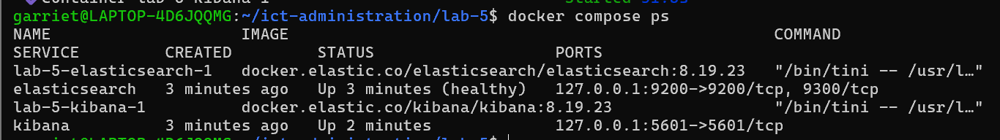

Дальше нужно было проверить состояние самого кластера Elasticsearch.

В результате получили статус `green`. А значит все необходимые шарды распределены и доступны. 

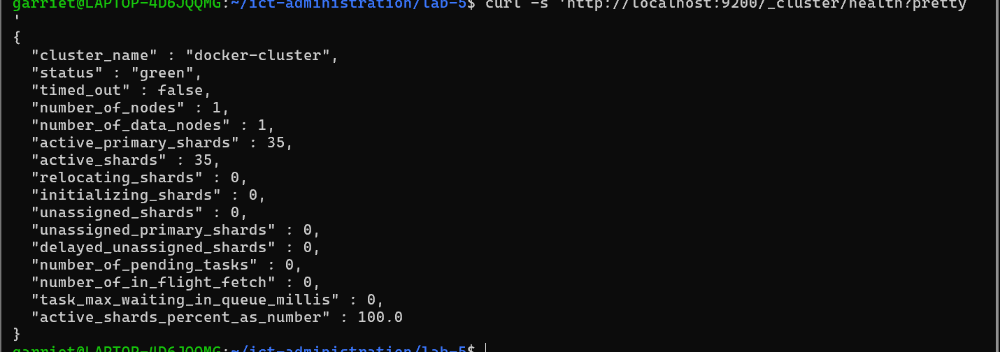

Вообще мы выяснили, что на одном узле кластер Elasticsearch часто бывает жёлтым. Это происходит из-за реплик: Elasticsearch не может разместить реплику на том же узле, где уже находится основной шард.

Чтобы кластер стал зелёным, можно добавить ещё один узел, на котором будут храниться реплики, либо установить количество реплик равным нулю. Для нашей локальной лабораторной мы использовали второй вариант, поскольку отдельный узел здесь не требовался.

Конечно, в реальной системе отключать реплики вряд ли супер идея, но.....

### Создание индекса и загрузка логов

Когда Elasticsearch заработал, мы перешли к созданию индекса для хранения логов.

Настоящего приложения у нас не было, поэтому для проверки мы использовали 20 тестовых записей, которые нам создал чатгпт.

Для времени событий использовали тип `date`, для уровня лога, названия сервиса и идентификатора запроса — `keyword`, а для текста сообщения — `text`.

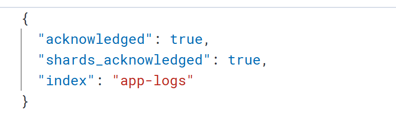

После этого загрузили подготовленные записи через Bulk API. Так получается отправить сразу несколько документов одним запросом, а не добавлять каждый отдельно, ибо это долго.

Также мы использовали разные названия сервисов и идентификаторы запросов.

После загрузки проверили количество документов. Elasticsearch показал 20 записей, то есть все логи добавились.

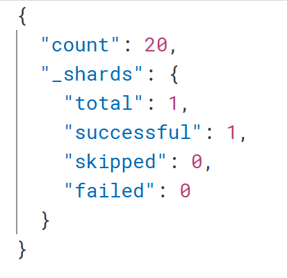

### Поиск по логам

Теперь можно было проверить, насколько удобно Elasticsearch позволяет находить нужную информацию.

Сначала мы попробовали поиск по полю `message`. (Искали сообщения, связанные с `timeout`).

Elasticsearch нашёл такие записи:

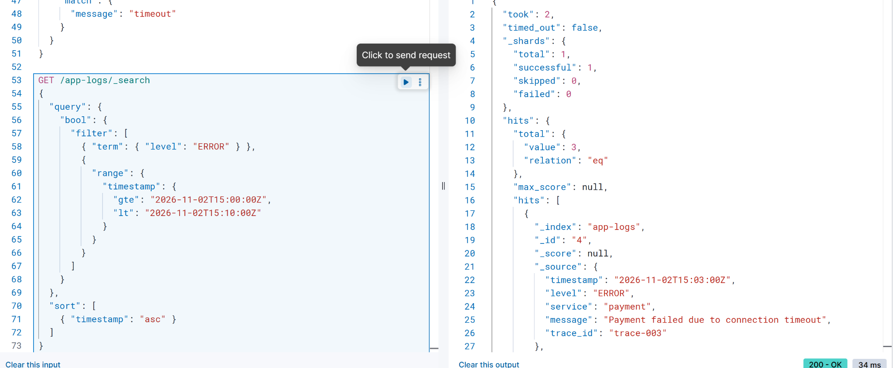

Затем мы решили сделать поиск более точным и добавили фильтрацию по уровню `ERROR` и временному диапазону.

Так можно быстро найти ошибки, чтобы не просматривать все события подряд.

Также проверили поиск по `trace\\\\\\_id`. Мы узнали что так мы сможем находить записи, относящиеся к одному запросу, даже если они были в разных сервисах.

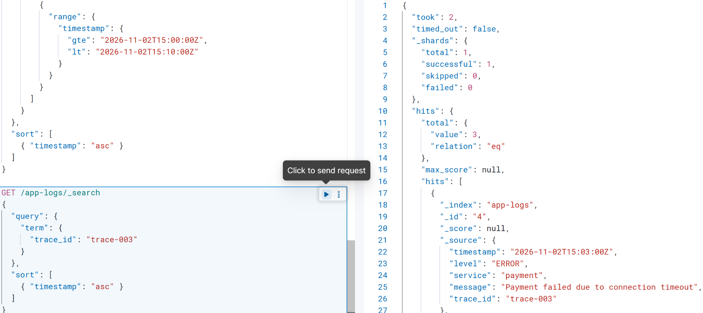

### Агрегация логов

Следующим заданием была агрегация. Мы решили посчитать, сколько сообщений каждого уровня находится в индексе.

Для этого сгруппировали записи по полю `level`.

Получилось 10 сообщений `INFO`, 5 сообщений `WARN` и 5 сообщений `ERROR`.

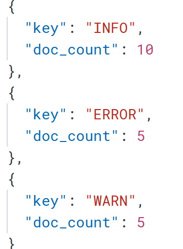

Получается, что половина всех записей была информационной, а остальные поровну разделились между предупреждениями и ошибками.

### Работа с Kibana

После мы посмотрели как эти же данные отображаются в Kibana.

Для этого перешли в Discover и настроили отображение логов.

И тут возникла первая проблема: записи почему-то не показывались, хотя до этого Elasticsearch успешно их находил.

Сначала мы подумали, что неправильно настроили индекс итд. Но потом оказалось, что в Kibana по умолчанию стоял временной диапазон последние 15 минут, а тестовые записи то относились к другому времени.

После изменения все логи появились.

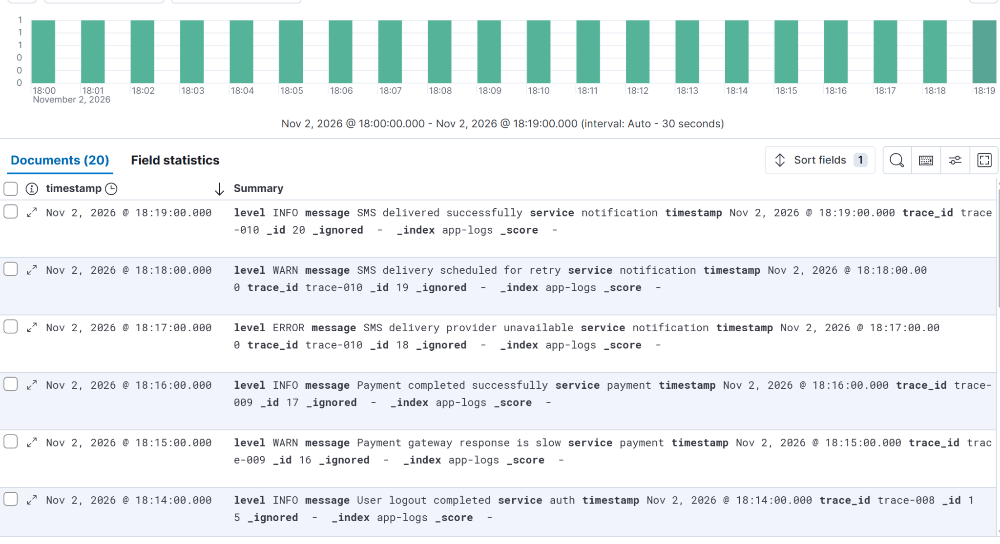

Дальше мы перешли к созданию визуализации. Для этого использовали Kibana Lens и построили столбчатую диаграмму по уровням логов.

Получилось три столбца: INFO, WARN и ERROR.

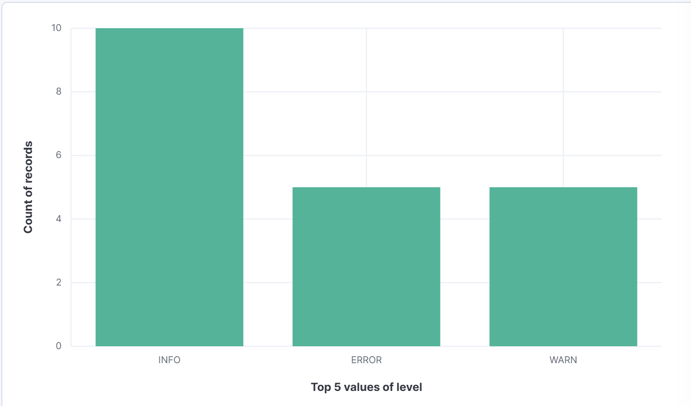

### Настройка ILM

Следующая часть оказалась посложнее, потому что было тяжело разобраться с автоматической ротацией индексов.

Мы должны не хранить вообще все логи в одном индексе.

Для этого в Elasticsearch есть ILM. Оно нужно для управления жизненным циклом индексов.

Мы создали политику `app-logs-policy` и настроили две фазы: `hot` и `delete`.

В первой фазе индекс должен переходить к следующему после достижения установленного порога. Для проверки мы выбрали 20 документов или 1 день.

Во второй фазе предусмотрели удаление старых индексов через короткий промежуток времени.

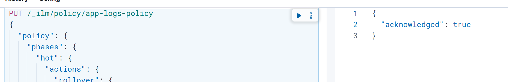

Саму политику мы сохранили в файле `elasticsearch/ilm-policy.json`, чтобы настройки остались в проекте.

### Шаблон индекса и rollover

Одной политики ILM оказалось недостаточно. Нужно было ещё и сделать так, чтобы Elasticsearch понимал, к каким индексам её применять и куда девать новые документы.

Для этого мы создали шаблон `app-logs-template` и настроили псевдоним `app-logs-write` чтобы приложение могло отправлять логи по одному и тому же имени, даже когда настоящий индекс изменен.

Например, сначала запись идёт в `app-logs-000001`, а после ротации — в `app-logs-000002`. При этом приложению не нужно каждый раз узнавать новое имя индекса.

Во время настройки у нас возникла небольшая путаница с запросами в Dev Tools. В какой-то момент мы случайно удалили прошлый запрос, из-за чего Elasticsearch вернул ошибку HTTP 400.

Пришлось еще проверить, что именно отправляется в консоли, и исправить запрос. А потом индекс `app-logs-000002` вообще не появлялся оказалось надо ждать около 10 мин.

Но после ожидания все появилось. 

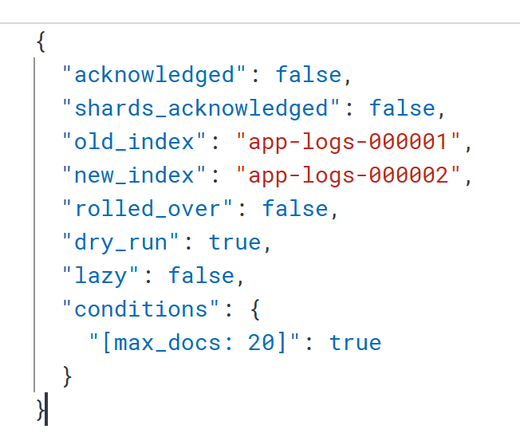

Затем мы отдельно проверили список индексов через `\\\\\\_cat/indices`.

В списке были видны `app-logs-000001` и `app-logs-000002`.

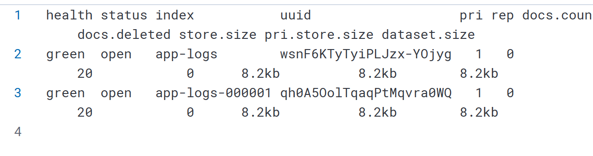

В итоге мы разобрались, что шаблон отвечает за настройки новых индексов, ILM управляет их жизненным циклом, а псевдоним позволяет продолжать запись без изменения имени, которое использует приложение.

### Настройка мониторинга

После работы с логами осталось настроить мониторинг Elasticsearch.

Для этого мы выбрали Prometheus и Grafana. Prometheus нужен для сбора метрик, а Grafana помогает понятно отображать их на графиках.

Но как оказалось Elasticsearch не предоставляет метрики напрямую в формате Prometheus, поэтому пришлось добавить ещё один контейнер — Elasticsearch Exporter.

Он получает показатели Elasticsearch и передаёт их в формате, который понимает Prometheus.

Мы добавили необходимые сервисы в Docker Compose, настроили файл `prometheus.yml` и запустили контейнеры.

Затем проверили, получает ли Prometheus данные от Exporter.

На странице целей мониторинга Elasticsearch отображался со статусом `up`.

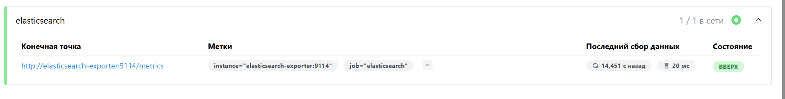

Это означало, что метрики действительно поступают и теперь их можно использовать в Grafana.

### Создание графиков в Grafana

Дальше мы открыли Grafana и создали дашборд «Мониторинг Elasticsearch».

Для него выбрали три показателя, которые показались нам наиболее полезными информативными итд.

**Первый — состояние кластера Elasticsearch.**

Он нужен, чтобы понимать, все ли данные доступны и нормально ли работают шарды.

Если кластер становится жёлтым, это может означать, что некоторые реплики не удалось распределить. Если он становится красным....уже все плохо

Поэтому за состоянием кластера надо быследить.

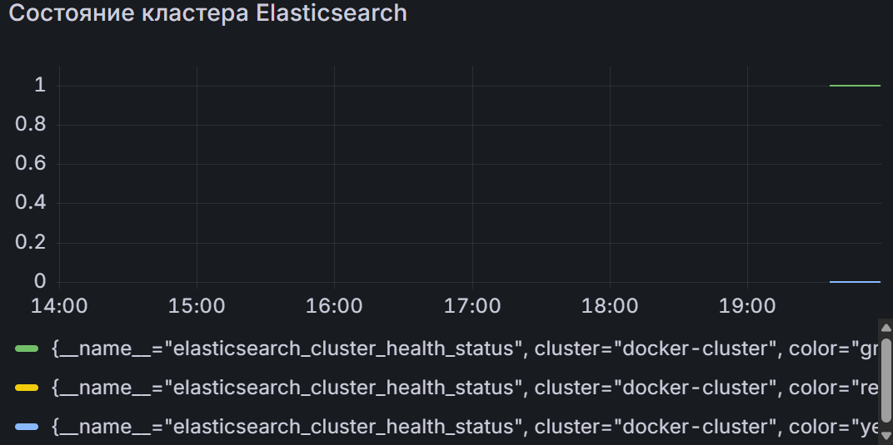

**Второй — свободное место на диске.**

Elasticsearch постоянно сохраняет данные, поэтому при большом количестве логов место может закончиться.

Если свободного места станет слишком мало, Elasticsearch может начать ограничивать запись, а новые логи перестанут нормально сохраняться.

Поэтому этот показатель тоже важен нам.

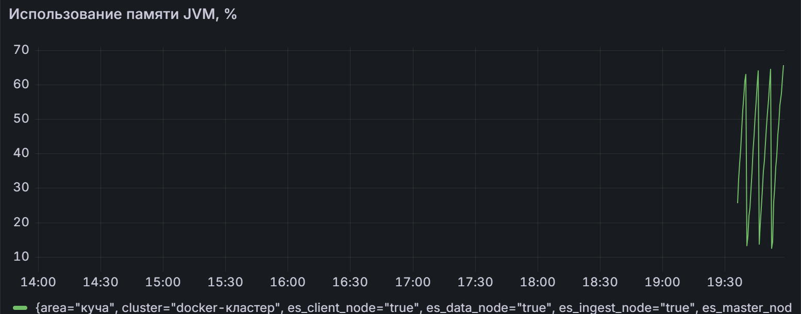

**Третий показатель — использование памяти JVM.**

Elasticsearch работает на Java и использует память JVM.

Если память будет постоянно сильно загружена, система может начать работать медленнее, а запросы будут обрабатываться очень и очень долго.

В худшем случае могут возникнуть проблемы со стабильностью сервиса.

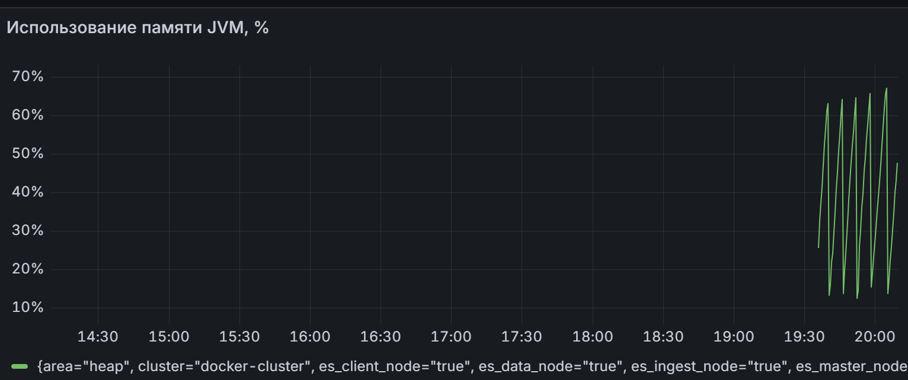

С самими графиками пришлось тоже нелегко.

Один из графиков долго не появлялся, хотя остальные уже были созданы. Мы перепроверяли его настройки и запрос, потому что сначала было непонятно, почему он не отображается. Так и не понятно в чем была его проблема, но главное появился

Для этих показателей мы бы настроили оповещения при ухудшении состояния кластера, критическом уменьшении свободного места и длительном высоком использовании памяти JVM.

Сами уведомления в этой работе мы не настраивали, но выбрали показатели, за которыми действительно полезно следить, и разобрались, какие проблемы они могут показывать.

### Как запустить лабораторную

Все сервисы мы запускали локально через Docker Compose.

Чтобы повторно запустить проект, нужно открыть папку `lab-5` и выполнить `docker compose up -d`.

После запуска Elasticsearch доступен по адресу `localhost:9200`, Kibana — `localhost:5601`, Prometheus — `localhost:9090`, а Grafana — `localhost:3000`.

Проверить состояние контейнеров можно через `docker compose ps -a`, а остановить их — через `docker compose down`.

Основные конфигурации Docker, Elasticsearch и Prometheus находятся в папке лабораторной.

Для Elasticsearch отдельно сохранены политика ILM, шаблон индекса и настройки псевдонима. При этом для полного повторения работы с логами необходимо также создать индекс и загрузить тестовые записи, как мы делали во время выполнения задания.

## Вывод

В этой лабораторной мы впервые попробовали работать с Elasticsearch и Kibana.

Сначала разобрались с запуском сервисов через Docker, потом создали индекс, загрузили тестовые записи и научились находить нужные события с помощью поиска и фильтров.

Также попробовали агрегацию и визуализацию данных в Kibana. Отдельно разобрались с ILM и rollover — теперь стало понятнее, как Elasticsearch может автоматически создавать новые индексы, чтобы не хранить все логи в одном месте.

В последней части мы настроили Prometheus и Grafana и создали три графика для мониторинга Elasticsearch.

Не всё получалось сразу, особенно тяжко с отображением логов в Kibana, графиков в Grafana, но в итоге удалось разобраться с возникшими проблемами.

